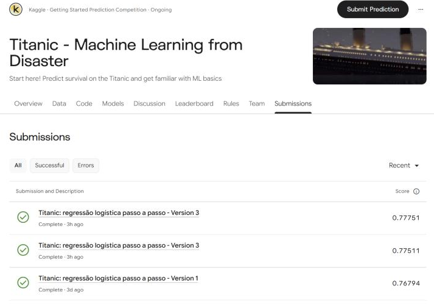

# Titanic: regressão logística passo a passo

Notebook feito para a competição [Titanic - Machine Learning from Disaster](https://www.kaggle.com/competitions/titanic), do Kaggle. O objetivo é prever quais passageiros sobreviveram ao naufrágio, um problema de classificação binária.

## Como obter os dados

Os dados pertencem à competição e não estão neste repositório, porque as regras limitam a redistribuição.

1. Entre na [página da competição](https://www.kaggle.com/competitions/titanic) e aceite as regras.
2. Baixe `train.csv` e `test.csv` na aba **Data**.
3. Coloque os dois arquivos na pasta `data/`, na raiz do projeto.

No Kaggle, o notebook encontra os dados sozinho e não precisa dessa pasta.

## Como rodar

Requer Python 3.12 ou superior.

Crie o ambiente virtual e ative-o. No Windows (PowerShell):

```powershell
python -m venv .venv
.\.venv\Scripts\Activate.ps1
```

No Linux ou no macOS:

```bash
python3 -m venv .venv
source .venv/bin/activate
```

Instale as dependências e abra o notebook:

```bash
pip install -r requirements.txt
pip install notebook
jupyter notebook titanic-regressao-logistica.ipynb
```

Ao rodar localmente, os arquivos de submissão são salvos em `outputs/`.

## Etapas

1. **Exploração dos dados:** tamanho, tipos, valores nulos e taxas de sobrevivência por sexo, classe e idade.
2. **Pré-processamento:** tratamento de nulos, conversão de colunas em números e remoção de colunas que não entram no modelo. As estatísticas vêm só dos dados de treino, para evitar vazamento.
3. **Baseline:** a regra "todas as mulheres sobrevivem", usada como ponto de comparação.
4. **Regressão logística:** treino do modelo e interpretação dos coeficientes.
5. **Validação:** separação estratificada de 20% do treino, acurácia e matriz de confusão.
6. **Submissão:** treino com todos os dados e geração do CSV com `PassengerId` e `Survived`.

## Resultados

| Modelo | Acurácia de validação | Score público |
|---|---|---|
| Regressão logística original | 80,4% | 0,76794 |
| Regressão logística com features novas | 83,8% | 0,77511 |
| Random Forest com features novas | 82,7% | 0,77751 |

O melhor score público foi o da Random Forest, com 1 passageiro a mais que a regressão logística com features novas, uma diferença pequena demais para apontar um vencedor. A validação usa 179 passageiros, e os três scores públicos ficaram abaixo dela.



## Conclusões e próximos passos

**Conclusões**

- `Sex` e `Pclass` se mostraram sinais fortes de sobrevivência, tanto na exploração quanto nos coeficientes do modelo.
- As features novas (`FamilySize`, `IsAlone` e `Title`) melhoraram o resultado da regressão logística.
- A validação usa uma única separação com poucos passageiros, então os resultados dela devem ser lidos com cautela.

**Próximos passos**

- Usar validação cruzada para comparar modelos com mais segurança.
- Preencher `Age` por grupo, como título ou classe, em vez de usar uma mediana geral.
- Extrair o deck, a letra inicial de `Cabin`, tratando os valores ausentes como uma categoria.
- Ajustar hiperparâmetros depois de ter uma validação mais confiável.
